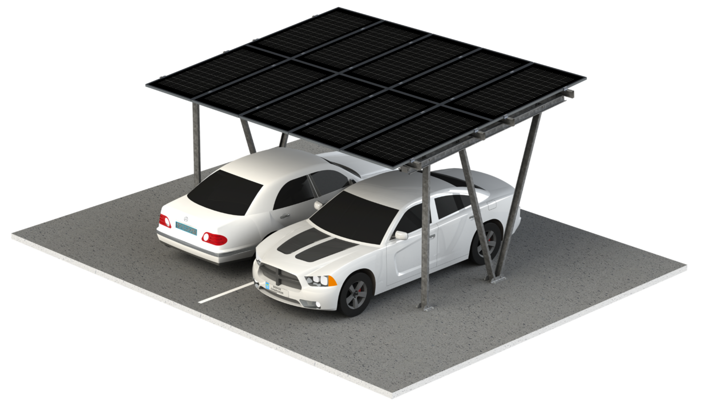
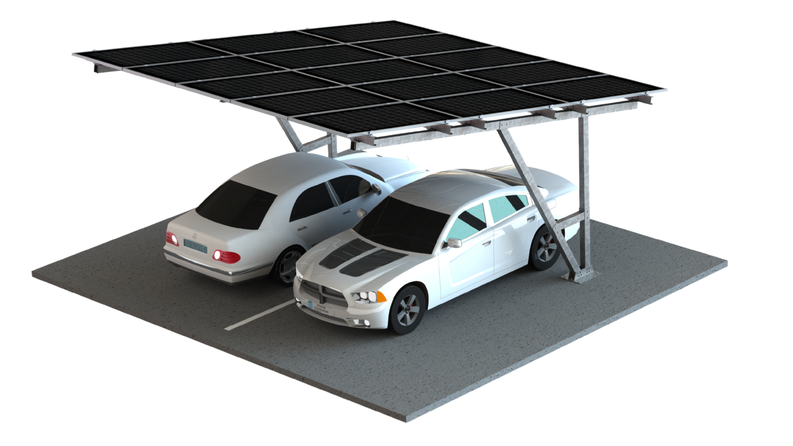
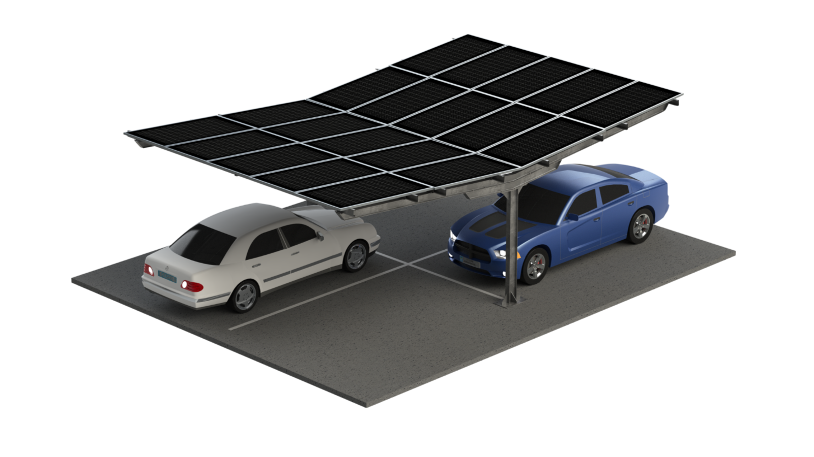
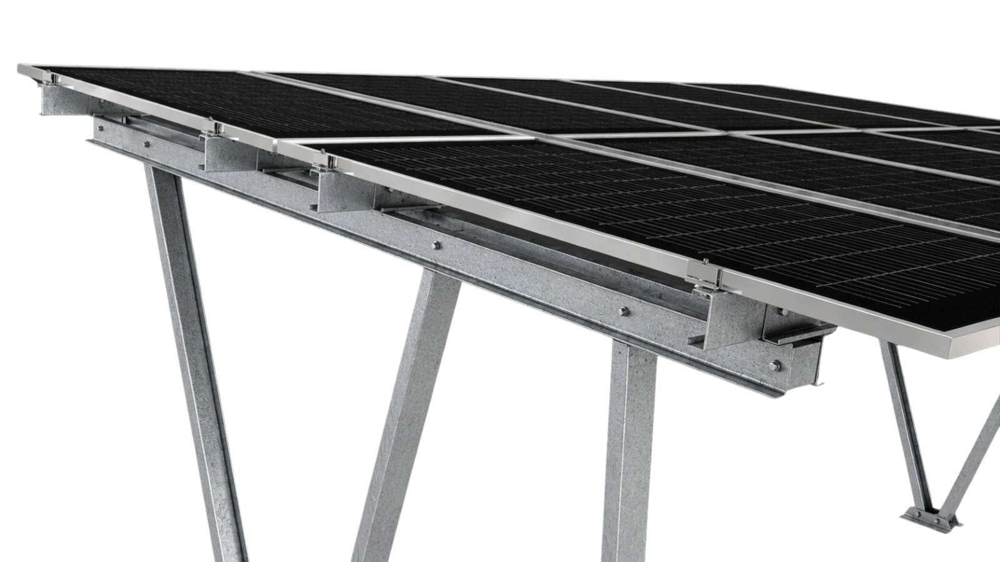

# Estrutura para carport solar: Guia do Iniciante para escolher a configuração ideal para seu estacionamento

Escolher uma **estrutura para carport solar** fica mais simples quando você sabe quais informações comparar. Neste guia, integradores e gestores vão entender como relacionar layout, circulação, vagas e módulos para iniciar a análise do estacionamento com critérios claros.

Mesmo conhecendo o conceito de cobertura solar, é comum ter dúvidas ao transformar a ideia em projeto: onde posicionar os pilares? Como preservar as manobras? A quantidade de módulos cabe na área disponível?

O carport precisa conciliar geração solar, cobertura de veículos e organização do estacionamento. A seguir, você verá como preparar esse levantamento e avaliar configurações com apoio da engenharia.

*Render oficial SSM: Carport Standard 2 linhas. Fonte: Renders Produtos SSM, p. 82.*

## O que significa escolher a configuração do carport?

A configuração é a organização da estrutura no espaço: posição dos pilares, distribuição dos apoios, geometria da cobertura e disposição dos módulos sobre as vagas.

Por exemplo, uma fileira junto ao limite do terreno exige estudar interferências diferentes das encontradas entre duas faixas de circulação. São situações ilustrativas, não indicações automáticas de um modelo.

Para revisar o conceito, consulte o conteúdo da SSM sobre [o que é carport solar](https://ssmdobrasil.com.br/2026/10/01/o-que-e-carport-solar-entenda-como-estacionamentos-podem-gerar-energia/). Agora, o primeiro passo é observar o funcionamento do estacionamento.

## Como a configuração estrutural interfere no layout do estacionamento?

A estrutura para estacionamento solar precisa ser compatível com a ocupação e o uso cotidiano da área. Comece sobrepondo a proposta de cobertura à planta das vagas.

### Disposição dos pilares

Observe a posição dos pilares em relação às portas dos veículos, às divisas das vagas e aos trajetos de pedestres. Um apoio pode parecer adequado no desenho da cobertura e criar dificuldade no embarque.

Marque esses possíveis conflitos antes de comparar alternativas. Quantidade e espaçamento dos pilares dependem da avaliação estrutural.

### Pontos de fixação no solo

Localize os pontos previstos para os apoios e identifique possíveis interferências com tubulações, drenagem, caixas e outras instalações enterradas.

O pavimento existente não comprova, por si só, que a fixação proposta seja adequada. A solução de fundação e ancoragem precisa ser definida conforme as condições verificadas no local.

### Circulação de veículos e áreas de manobra

Desenhe os percursos de entrada, saída e estacionamento. Inclua curvas, marcha a ré e encontros entre veículos, considerando os tipos que realmente utilizam a área.

Como referência de planejamento, o [guia de carports da Universidade de Michigan](https://graham.umich.edu/media/files/CLCF/CLCF-2025-Coldwater-Solar-Carport-Guide.pdf) relaciona dimensões das vagas, corredores e circulação à definição da cobertura. A análise deve preservar o funcionamento do conjunto.

### Quantidade e dimensões das vagas

Registre quantas vagas existem e quantas precisam permanecer após a implantação. Diferencie vagas comuns, acessíveis e destinadas a veículos com necessidades específicas.

Compare as dimensões úteis com a posição dos elementos estruturais. A projeção da cobertura e o espaço disponível para estacionar são informações distintas e precisam aparecer no levantamento.

*Render oficial SSM: Carport Elite 2 linhas. Fonte: Renders Produtos SSM, p. 70.*

## Quais informações avaliar antes de desenvolver um carport solar?

Com os conflitos mapeados, reúna os dados que permitirão avaliar a viabilidade da proposta. O objetivo é apresentar à engenharia um retrato confiável do local.

### Planta do estacionamento

Separe uma planta atualizada com medidas, limites, vagas, obstáculos e identificação das áreas que poderão receber cobertura. Informe também o que precisa ser preservado.

Na ausência de uma planta, organize um levantamento inicial com medidas e registros do local. Sinalize quais dados ainda precisam ser conferidos para evitar que estimativas sejam tratadas como dimensões definitivas.

### Acessos e circulação

Identifique portões, entradas de pedestres, rotas acessíveis, áreas de carga e descarga e caminhos que precisam permanecer livres.

Registre os horários de maior movimento. Esse dado ajuda a discutir a implantação e eventuais restrições de obra com o responsável pela operação.

### Quantidade de módulos

Informe a quantidade pretendida e encaminhe a ficha técnica dos módulos, incluindo dimensões e massa. Se o modelo ainda não estiver definido, registre essa pendência.

A contagem de módulos, isoladamente, não determina a área da cobertura nem o número de vagas atendidas. A disposição precisa ser compatibilizada com o layout e com os requisitos de instalação do fabricante.

### Características específicas do local

Inclua cidade, condições do terreno, desníveis, obstáculos e informações disponíveis sobre o solo. Identifique árvores e edificações que possam produzir sombras.

O [guia Solar car parks, do BRE](https://www.britishparking.co.uk/write/Documents/89087_BRE_solar_carpark_guide_v2_bre114153_lowres.pdf), aborda a seleção do local, o desenho do estacionamento e as opções de fundação como partes do planejamento. Use a referência para organizar perguntas; as definições técnicas precisam considerar o projeto brasileiro.

| Critério de análise | O que observar | Por que influencia o projeto |
|---|---|---|
| Layout | Fileiras, obstáculos e limites | Orienta a distribuição da cobertura e dos apoios. |
| Vagas | Quantidade, dimensões e usos | Permite avaliar o espaço útil para estacionar. |
| Circulação | Corredores, curvas e manobras | Ajuda a identificar conflitos com a estrutura. |
| Acessos | Portões, pedestres e rotas livres | Define áreas que precisam permanecer desobstruídas. |
| Módulos | Quantidade, dimensões e massa | Fundamenta a compatibilização da cobertura. |
| Área disponível | Medidas, desníveis e interferências | Delimita as possibilidades de implantação. |

## Carport solar para empresas, indústrias, comércios e condomínios

O uso do estacionamento muda as prioridades da análise. Em empresas, considere a chegada de colaboradores e a circulação de visitantes. Em indústrias, verifique a convivência com frotas, utilitários e operações logísticas.

Nos comércios, observe a rotatividade, o embarque de passageiros e os percursos até as entradas. Em condomínios, registre a distribuição das vagas, os acessos e a circulação compartilhada.

Esses exemplos ajudam a montar o briefing. Nenhum segmento determina sozinho a configuração ideal. Para ampliar essa avaliação, veja o artigo sobre [carport solar para negócios](https://ssmdobrasil.com.br/2026/06/19/o-que-e-carport-solar-beneficios-e-como-escolher-o-melhor-tipo-para-seu-negocio/).

*Render oficial SSM: Carport Titan 4 linhas. Fonte: Renders Produtos SSM, p. 74.*

## Como a engenharia transforma o layout em solução estrutural?

O próximo passo é compatibilizar os dados levantados. A análise estrutural considera as condições do local e as ações previstas; o projeto fotovoltaico avalia a distribuição dos módulos e a geração esperada.

*Fluxo ilustrativo de planejamento. As etapas e os documentos necessários variam conforme o projeto.*

Na comparação de propostas, verifique se todas partem do mesmo layout e dos mesmos módulos. Confira o escopo de fornecimento, as interfaces com fundações e os requisitos ainda pendentes.

Pergunte também como serão tratados o escoamento da água e a expectativa de proteção dos veículos. Uma cobertura solar para estacionamento precisa ter seus detalhes de vedação e drenagem definidos; a presença dos módulos não permite presumir estanqueidade integral.

Conheça as [soluções Carport da SSM](https://ssmdobrasil.com.br/solution/carport/) e avalie sua aplicação conforme o projeto. Não existe uma linha universalmente superior para todos os estacionamentos.

*Render oficial SSM: detalhe da estrutura Carport Standard. Fonte: Renders Produtos SSM, p. 48.*

## Black Friday SSM: condição de novembro para Carport

**Condições exclusivas durante novembro para Carport a partir de 10 módulos, em 2 linhas de 5.**

Ao consultar essa condição, compartilhe as informações do estacionamento e dos módulos pretendidos. A configuração comercial de partida precisa ser avaliada em relação à aplicação. Valores, prazos e detalhes do fornecimento devem ser consultados com a SSM.

## FAQ: dúvidas sobre a escolha da estrutura

### O número de módulos define quantas vagas serão cobertas?

Não. As dimensões e a disposição dos módulos precisam ser relacionadas às medidas das vagas e à geometria da cobertura.

### Posso escolher apenas pela área total do estacionamento?

A área é um ponto de partida. Acessos, circulação, obstáculos e posições possíveis dos apoios também precisam ser considerados.

### A fixação pode ser definida pelo pavimento existente?

A definição exige avaliação das condições de apoio e da solução de fundação e ancoragem prevista para o projeto.

### O que enviar para iniciar a análise?

Envie localização, planta ou levantamento com medidas, quantidade de vagas, acessos e dados dos módulos pretendidos.

## Conclusão: a configuração adequada começa pela análise do projeto

Agora você tem um roteiro para avaliar uma estrutura para carport solar: mapear o estacionamento, identificar conflitos, reunir informações e comparar soluções com apoio técnico.

Essa preparação conecta o objetivo de geração à cobertura dos veículos e ao funcionamento das vagas. Quanto mais claro o levantamento, mais consistente será a discussão sobre a configuração adequada.

**Compartilhe o layout do estacionamento com a SSM e avalie a solução para seu projeto.**

---

*Conteúdo institucional preparado para a SSM do Brasil com auxílio do Codex em 17 de novembro de 2026. A SSM fornece estruturas para aplicações fotovoltaicas. Este guia orienta o levantamento inicial; as especificações dependem da engenharia responsável pelo projeto.*
